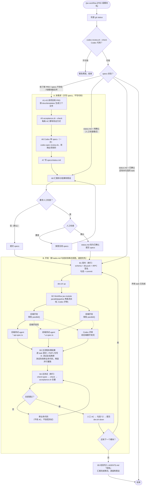

# AI 开发工作流

只有一个入口命令 `/jax-workflow`。它先判断 `specs/` 是否完整：不完整就拆 PRD，默认拆完直接开发（参数带 `--confirm` 或说明需要人工检查时，才停下来等人工确认）；完整就从断点继续开发，一直做到交付。

命令文件在 `.claude/commands/jax-workflow.md`，specs 模板在 `docs/templates/`，项目规范在 `AGENTS.md`（`CLAUDE.md` 引用它，Claude Code 和 Codex 读的是同一份）。

原则：**规则能交给脚本和配置执行的，就不写在 prompt 里**。prompt 只留需要模型判断的事。

| 由谁保证 | 内容 |
|---|---|
| `.claude/settings.json` 权限 | 禁止 `git push`、禁止改 `.env`、禁止装全局依赖 |
| `scripts/hooks/commit-gate.sh`（PreToolUse hook） | 每次 `git commit` 前跑 `pnpm check-types` 和 `pnpm check`，不过就拦下提交，只把关键报错回给 Claude |
| `scripts/module-plan.mjs` | 解析 `tasks.md`：还没做的 task 按层（契约 / 后端 / 前端 / 验证）分组，带依赖和文件，作为 Workflow 的输入 |
| `.claude/workflows/jax-module.js`（Workflow 脚本） | 后端、前端两条 `pipeline()` 同时跑，每条"开发 → 测试"，开发按批 `parallel()`；Codex 评审和流水线并行，等两边开发完开始 |
| `scripts/acceptance.sh` | AC 有没有写验证方式、测试是否齐全和通过；`--layer api/ui` 分层跑（可同时跑），不带参数是串行总测试，通过的 AC 由脚本勾选 |
| `scripts/dev.sh` | 检查数据库 → `db:push` → 后台启动 dev → 等端口就绪 |
| `scripts/codex-review.sh`、`scripts/codex-spec-review.sh` | Codex 评审代码、审 specs |

## 流程图

GitHub、VS Code（装 Markdown Preview Mermaid Support 插件）和飞书文档都能直接渲染下面这张图。`docs/jax-workflow-flowchart.{png,svg}` 是旧版导出，以这张 Mermaid 图为准。



## 断点续跑

所有进度都写在文件里，中断后再执行 `/jax-workflow` 就从第一个没勾的 task 继续：

- `specs/status.md`：拆分是否已确认
- `tasks.md` 的 `基线提交`：本模块开始前的提交，评审从这里算起
- `tasks.md` 的 task 勾选：契约 → 前端 / 后端 → `R` 代码评审、`TA` 后端测试、`TU` 前端测试 → `TZ` 总测试，评审做没做过也有记录，不会重复评审或漏评审
- Workflow 运行到一半中断：同一个会话里用 `resumeFromRunId` 续跑（已完成的 agent 直接复用结果）；换了会话，就按 `git status` 里没提交的改动和勾选状态接着做
- `requirements.md` 的 AC 勾选：由 `acceptance.sh` 根据测试结果写入

## 设计要点

| 设计 | 为什么 |
|---|---|
| 一个入口，按 specs 状态分支 | 不用记该跑哪个命令；中断后再执行同一个命令就能接着做 |
| 门禁、权限、状态交给脚本和配置 | prompt 里的"记得检查"模型可能跳过，hook 和权限配置一定生效（参考 Shopify、Anthropic 2026 的做法） |
| 每条 AC 写明验证方式，Codex 开发前审一次 | 开工前就约定"做完"的标准（参考 Anthropic 的 sprint contract） |
| 先定契约，前端、后端并行开发 | 前端只依赖接口签名不依赖实现，两边同时写；改同一个文件的 task 由脚本自动排成先后 |
| 前后端各是一条流水线，本层开发完立刻测试；评审同时跑，最后串行总测试 | 不用等最慢的一层；评审和测试都只读代码，修复后的代码由串行总测试兜底 |
| 测试分 api / ui 两层，由只看需求的 agent 写，脚本判定 | 写代码的不自己判断做完没有；接口行为用请求测更快更稳，页面只测用户看得到的部分 |
| 编排用固定的 Workflow 脚本，扇出数量由 tasks.md 决定 | 结构固定、每次跑法一致，出了问题能复现；并行度随模块大小自动变化 |
| 评审只用 Codex、只做一轮，修完不复查 | 写代码和评审用不同模型；多轮评审慢、费 Token，还容易偏离需求 |
| P0/P1 先写失败测试复现再修 | 过滤评审误报，修完也留下回归测试（参考 Shopify 用测试当裁判） |
| 默认拆完直接开发，`--confirm` 才停下 | 小需求一条命令跑到底；重要需求开发前人工补漏成本最低 |
| PRD 不清楚的记"假设"，高风险才停 | 减少不必要的中断，假设留在 specs 里事后可查 |
| 按需加载：模板、代码规范拆到单独文件 | AGENTS.md 和命令文件保持短，每个阶段只读需要的 |
| 经验沉淀到 AGENTS.md | 下一轮开发自动带上，工作流越用越贴合项目 |

## 准备

### 本机环境

- **Node.js 20 或以上**：Playwright 和 ultracite 都要求。Node 18 下 `pnpm check` 和 e2e 都跑不起来，commit hook 会拦下所有提交
- **PostgreSQL**：`apps/server/.env` 里的 `DATABASE_URL` 要能连上，`scripts/dev.sh up` 会先检查
- **Google Chrome**：Playwright 用本机 Chrome（`channel: "chrome"`），不额外下载浏览器

### Codex

`scripts/codex-review.sh` 调用 `codex review --commit <快照提交>`（见下文），`scripts/codex-spec-review.sh` 调用只读沙箱里的 `codex exec`，都用本机 Codex 登录的 ChatGPT 账号，会消耗 Codex 额度。找 codex 和选模型的逻辑在 `scripts/lib/codex.sh`：

- 查找顺序：环境变量 `CODEX_BIN` → PATH 里的 `codex` → Codex 桌面版自带的 CLI（`~/.codex/plugins/.plugin-appserver/codex-cli/bin/codex`）
- 模型默认 `gpt-6-luna`，可以用环境变量 `CODEX_MODEL` 换。不读 `~/.codex/config.toml` 里的 `model`，因为那里的模型 ChatGPT 账号不一定能用（例如 `gpt-6-astra` 会报 `model_not_found`）

`codex review --base` 只看 `git diff <基线>`，看不到还没被跟踪的新文件，而 Workflow 是在提交之前评审的。所以 `codex-review.sh` 先用临时 index 把"基线 + 工作区里 `packages/`、`apps/` 的当前内容"拼成一个快照提交，再用 `codex review --commit` 评审它；真实的 index、HEAD 和工作区都不动，e2e 和工具链改动不进评审范围。

```bash
scripts/codex-review.sh --check
```

不可用时：没找到 codex 就装 Codex 桌面版或 `npm install -g @openai/codex`；没登录就在终端执行 `codex login`。Codex 不可用时 `/jax-workflow` 会在入口直接结束，不会用子代理代替评审。

## 使用

1. 把 PRD 放到 `docs/prd/`（练习用的示例：`docs/prd/admin.md`）
2. 在项目根目录打开 Claude Code，执行 `/jax-workflow docs/prd/admin.md`，拆完需求会直接开发
3. 想先检查拆分结果再开发，执行 `/jax-workflow docs/prd/admin.md --confirm`：检查 `specs/` 下生成的内容，有问题直接让它改；没问题就回复"确认"
4. 中断后再次执行 `/jax-workflow`，会从未完成的 task 继续
