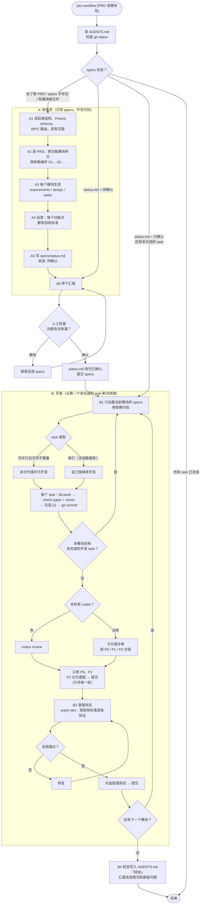

# AI 开发工作流

只有一个入口命令 `/jax-workflow`。它先判断 `specs/` 是否完整：不完整就拆 PRD，拆完停下来等人工确认；完整就从断点继续开发，一直做到交付。

命令文件在 `.claude/commands/jax-workflow.md`，项目规范在 `AGENTS.md`（`CLAUDE.md` 引用它，Claude Code 和 Codex 读的是同一份）。

## 流程图

GitHub、VS Code（装 Markdown Preview Mermaid Support 插件）和飞书文档都能直接渲染下面这张图。



### 文字版

```
/jax-workflow [PRD 或模块名]
│
├─ 0. 入口：读 AGENTS.md → 检查 git status → 判断 specs 状态
│     │
│     ├─ 给了新的 PRD ／ specs 不存在 ／ 有模块缺文件 ──→ A. 拆需求
│     ├─ status.md = 待确认 ──→ 重新汇报，等确认
│     ├─ status.md = 已确认，还有未勾选的 task ──→ B. 开发（断点续跑）
│     └─ 所有 task 已完成 ──→ 结束
│
├─ A. 拆需求（只写 specs，不写代码）
│     ├─ A1. 读目录结构、现有 Prisma schema、tRPC 路由、页面
│     ├─ A2. 读 PRD，按功能模块拆分（按依赖编号 01-、02-…）
│     ├─ A3. 每个模块生成 requirements.md / design.md / tasks.md
│     ├─ A4. 自查：PRD 每个功能点都有对应的验收标准
│     ├─ A5. 写 specs/status.md（状态: 待确认）
│     └─ A6. 停下汇报 ──→ 【人工检查：功能有没有漏、拆得合不合理】
│                 │
│                 ├─ 要改 ──→ 改 specs → 再汇报
│                 └─ 确认 ──→ status.md 改为"已确认" → 提交 specs → 进入 B
│
└─ B. 开发（从第一个未勾选的 task 开始）
      │
      ├─ B1. 开发一个模块（只加载这个模块的 specs）
      │     │  按依赖分批：
      │     │  ├─ 可并行 且 文件不重叠 ──→ 派子代理并行
      │     │  └─ 串行（含改数据库） ──→ 自己按顺序做
      │     │  每个 task：db:push → check-types + check → 勾选 [x] → git commit
      │     ▼
      ├─ B2. 代码评审（一轮）
      │     │  有 codex ──→ codex review
      │     │  没有 ──→ 子代理按 P0 / P1 / P2 分级评审
      │     │  只修 P0、P1，P2 记为遗留 → 提交
      │     ▼
      ├─ B3. 冒烟测试
      │     │  pnpm dev → 按 requirements 的验收标准逐条验证
      │     │  不通过 ──→ 修复后重测
      │     │  通过 ──→ 勾选 → 提交
      │     ▼
      ├─ 还有下一个模块？ ──是──→ 回到 B1
      │
      └─ B4. 全部完成 → 经验写入 AGENTS.md「经验」一节 → 汇报
```

## 设计要点

| 设计 | 为什么 |
|---|---|
| 一个入口，按 specs 状态分支 | 不用记该跑哪个命令；中断后再执行同一个命令就能接着做 |
| 先建项目再拆 PRD | design 能写出真实的文件路径和表结构，不会脱离技术栈 |
| 拆完停下来人工确认，状态记在 `specs/status.md` | AI 拆需求会漏功能，开发前补上成本最低；状态写在文件里，换个会话也知道确认过没有 |
| 输出模板写死 | 开发阶段每次都能按同样的格式读 specs |
| task 标注依赖、文件、串行 / 并行 | 决定哪些能派子代理并行；数据库迁移并行会冲突 |
| 每完成一项就勾选并提交 | 中断后能从断点继续，评审也只看本模块的提交 |
| 按需加载上下文 | 每个阶段只读需要的文档，省 Token，减少跑偏 |
| 评审只做一轮，只修 P0、P1 | 多轮评审慢、费 Token，还容易偏离需求 |
| 经验沉淀到 AGENTS.md | 下一轮开发自动带上，工作流越用越贴合项目 |

## 使用

1. 把 PRD 放到 `docs/prd/`（练习用的示例：`docs/prd/admin.md`）
2. 在项目根目录打开 Claude Code，执行 `/jax-workflow docs/prd/admin.md`
3. 检查 `specs/` 下生成的内容，有问题直接让它改；没问题就回复"确认"
4. 它会接着开发。中断后再次执行 `/jax-workflow`，会从未完成的 task 继续
